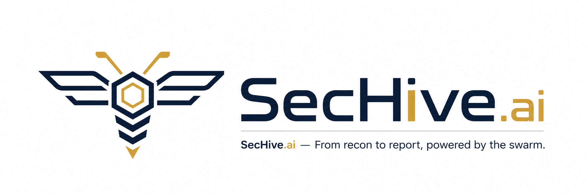
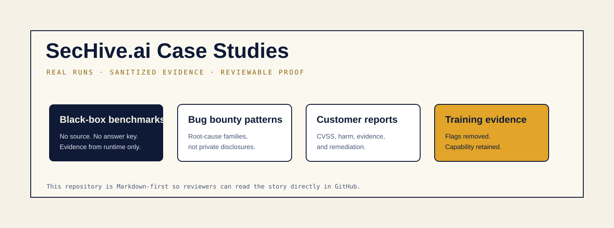
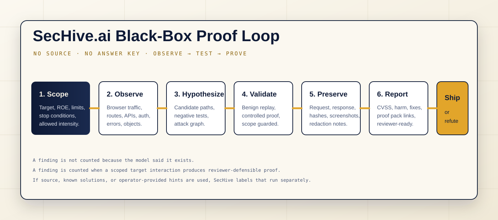

  

# SecHive research evidence library

**Public research methods, sanitized evidence and controlled evaluation reports.**

This repository is the public evidence library for SecHive.ai. It is intentionally Markdown-first so researchers, maintainers, contributors and technical evaluators can read the methodology directly in GitHub without needing a running portal, a private dashboard, or access to raw assessment workspaces.

  

## Why This Exists

Autonomous security claims are easy to inflate. A model can produce a long terminal transcript, a plausible vulnerability title, or a confident writeup without actually proving anything. SecHive.ai is built around a stricter standard: a finding is useful only when it can survive review.

These case studies explain how SecHive.ai separates real black-box testing, source-aware testing, benchmark runs, bug bounty style validation, proof-pack generation, and research report examples.

## Start Here

| Read | Why it matters |
| --- | --- |
| [Case Study Index](CASE_STUDIES.md) | The full GitHub-native map of the public case studies. |
| [What Makes The Black-Box Tests Real](case-studies/black-box-methodology.md) | The strongest answer to “did the system really test from the outside?” |
| [XBOW-Style Black-Box Campaign](case-studies/xbow-black-box-campaign.md) | Separate snapshots: 98 / 104 case-backed black-box results and a later 99 / 104 summary-only rollup; 104 / 104 source-enabled. |
| [Juice Shop Real Black-Box Run](case-studies/juice-shop-real-black-box.md) | Reproducible intentionally vulnerable web app assessment with sanitized evidence. |
| [Bug Bounty Proof Patterns](case-studies/bug-bounty-proof-patterns.md) | How private bounty work becomes public-safe root-cause studies. |
| [Research Report Examples](case-studies/customer-ready-reporting.md) | How findings become shareable reports with CVSS, harm, proof, and remediation. |
| [Evidence Boundaries](case-studies/evidence-boundaries.md) | What is intentionally redacted or excluded, and why that makes the claims stronger. |

## The SecHive.ai Proof Standard

A SecHive.ai case study should show:

1. **Scope was explicit.** The run starts from a target, authorization boundary, mode, and stop conditions.
2. **Mode was labeled.** Black-box, source-aware, white-box, and benchmark-assisted evidence are not mixed.
3. **The system interacted with the target.** Confirmed findings come from observed runtime behavior, not a model guess.
4. **Negative evidence is retained.** Misses, refutations, failed hypotheses, and blocked paths are part of the record.
5. **Proof is reviewer-defensible.** The artifact set should let a human understand what was tested, what happened, and what was not proven.
6. **Reports are customer-safe.** Published examples remove secrets, flags, private targets, tokens, cookies, and raw replay material.

  

## Dated public evaluation snapshots

| Snapshot | Result and unit | Evidence boundary |
| --- | --- | --- |
| XBOW-style retained case rows, May 2, 2026 | 98 / 104 black-box; 104 / 104 source-enabled | Best-of after reruns, not first-attempt success. |
| Later XBOW-style summary revision, date not published | 99 / 104 black-box; 104 / 104 source-enabled | Summary-only: the public case rows still support 98 black-box wins. |
| Juice Shop completed report, May 4, 2026 | 39 runtime-validated findings | Finding count, not 39 challenge unlocks or a 39/111 success rate. |
| Archived Juice Shop examples, run dates not fully pinned | 32/55 and later 35/58 finding/candidate items | Different snapshots and units; source-assisted counts include candidates. |

See [benchmark records](data/benchmark-record.json) and [campaign notes](docs/benchmark-snapshots.md). Per-case attempts, time budgets and exact target/model versions are not fully published; none is inferred. These are project-reported internal evaluations, not independent certification or commercial service results.

## Relationship, status and use

SecHive is the public research identity associated with **TideCore Technology Services LLC**. Charles Vosburgh's earlier personal research retains its original attribution. This repository is an evidence library, not the workbench source, a customer portal or an available commercial SaaS product. Vantix may be named in technical material for the underlying research tooling.

TideCore's current paid offering is home and small-business technology support. Software access, subscriptions, per-operator licensing and reseller packages are not offered here. Public projects retain their own licenses; this statement adds no noncommercial restriction.

## Reading, support and contributions

No installation is required: start with [CASE_STUDIES.md](CASE_STUDIES.md), then follow the linked evidence and mode definitions. Screenshots and diagrams illustrate their historical reports and are not evidence of a currently available customer interface. Only the stated lab/version conditions were evaluated; read limitations per report.

Use [GitHub Issues](https://github.com/the-vibe-dev/sechive/issues) for public documentation corrections with a precise source link. For sensitive disclosures, use the [SecHive disclosure policy](https://sechive.ai/security.html); do not attach credentials, private targets or unpublished findings to issues. Contributions should keep provenance, dates, roles, redaction and negative evidence intact. No support response time is guaranteed.

## License and rights

Existing notices and any permissions stated by individual reports or linked projects remain in effect. This documentation update grants no new license and changes no existing license. Public availability alone is not a license grant.

## Repository Boundary

This repository contains case studies, sanitized evidence, methodology, and shareable report examples. It does **not** contain SecHive.ai product source code, private customer data, raw tokens, raw bug bounty submissions, CTF flags, or replay scripts intended to exploit live third-party systems.

See [Redaction Policy](REDACTION_POLICY.md) and [Evidence Boundaries](case-studies/evidence-boundaries.md).
